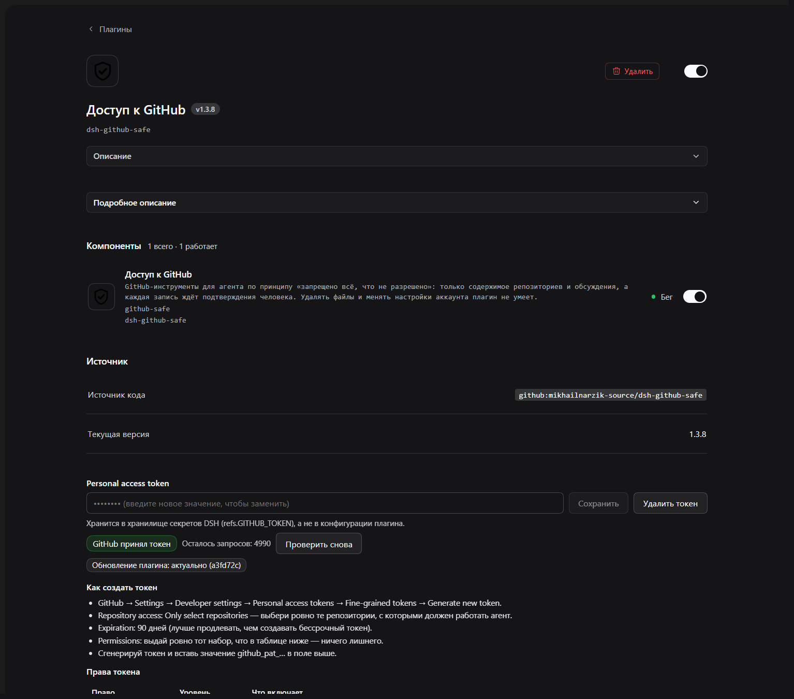

# dsh-github-safe — доступ к GitHub для ассистента

Плагин даёт ассистенту инструменты для работы с GitHub и одновременно ставит
жёсткую границу: он умеет читать репозитории, файлы, задачи и pull request, а
любое действие, которое что-то меняет, выполняется только после вашего
подтверждения.



*Страница плагина в интерфейсе DSH.*

## Что это и зачем

GitHub — сайт, где хранятся код и документация проектов. Ассистенту бывает нужно
заглянуть в репозиторий, прочитать файл, посмотреть открытые задачи, ответить на
замечание или создать pull request. Чтобы это было безопасно, плагин работает по
принципу **«запрещено всё, что не разрешено»**:

- есть список разрешённых операций (**allowlist**). Всё, чего в нём нет, плагин
  отклоняет, даже если GitHub технически позволил бы такую операцию;
- **чтение** (репозиторий, файлы, задачи, pull request, поиск) выполняется без
  вопросов;
- **каждая запись** (создать задачу, закоммитить файл, создать PR, релиз,
  репозиторий) сначала показывает вам запрос на подтверждение. Отказали — на
  GitHub ничего не поменялось;
- плагин **не умеет удалять** и не трогает аккаунт, профиль, организации и
  доступы.

Термины простыми словами:

- **репозиторий** — папка проекта на GitHub;
- **issue (задача)** — обсуждение или сообщение об ошибке;
- **pull request (PR)** — предложение внести изменения в проект;
- **коммит** — сохранённое изменение файлов;
- **токен (Personal access token)** — пароль для программного доступа к GitHub.
  Вы создаёте его сами и выдаёте только нужные права;
- **квота** — сколько запросов к GitHub ещё разрешено в текущий час.

Зачем это нужно: ассистент может сам прочитать нужный файл или подготовить PR, а
вы не даёте ему опасных прав «на всё». Другие интеграции выдают агенту токен и
общий GitHub-клиент — то есть теоретически любой запрос, включая удаление
репозитория. Здесь вместо этого единственная проверка перед каждым запросом.

## Как открыть

1. Левая панель DSH → **«Плагины»**. (В старых версиях этот раздел был в
   «Настройки → Плагины»; сейчас «Плагины» — отдельная страница слева.)
2. Найдите карточку **«Доступ к GitHub»** (пакет `dsh-github-safe`) и откройте её
   страницу.
3. На странице: блок **«Доступ к GitHub»** с полем **Personal access token**,
   вердиктом проверки и остатком квоты; ниже — разделы «Как создать токен»,
   «Права токена», «Не выдавай», «Что плагину разрешено»; в конце — раздел
   **«Подробности»** (этот документ).
4. Ассистенту ничего открывать не нужно: как только токен сохранён, инструменты
   `github_*` доступны в любой сессии.

## Как пользоваться пошагово

**Шаг 1. Создайте токен на GitHub.**

1. На странице плагина нажмите ссылку **«Создать токен на GitHub»** или откройте
   GitHub вручную: **Settings → Developer settings → Personal access tokens →
   Fine-grained tokens → Generate new token**.
2. **Token name** — любое понятное имя, например `dsh-github-safe`.
3. **Expiration** — 90 дней (лучше продлевать, чем создавать бессрочный токен).
4. **Repository access** → **All repositories**. Иначе новые репозитории не видны
   плагину, а создание нового не сработает.
5. **Repository permissions** — выдайте ровно тот набор, что в таблице ниже,
   ничего лишнего.

| Право | Уровень | Что включает |
| --- | --- | --- |
| Metadata | Read | обязателен всегда: сам доступ к репозиторию |
| Contents | Read and write | чтение файлов и коммиты: `github_file`, `github_file_write`, `github_push_files`, `github_release_create`, поиск кода |
| Issues | Read and write | задачи: список, чтение, комментарии, создание, закрытие |
| Pull requests | Read and write | PR: чтение, файлы, ревью, комментарии, merge |
| Commit statuses | Read | статусы коммитов (нужно, только если нужны проверки) |
| Checks | Read | CI-проверки pull request: `github_review` |
| Administration | Read and write | создание новых репозиториев: `github_repo_create` |

`Administration` нужен только для создания репозиториев. Без него работают все
остальные инструменты, но создать новый репозиторий не получится.

6. Нажмите **Generate token** и скопируйте значение `github_pat_…`.

**Шаг 2. Сохраните токен в DSH.**

1. Вернитесь на страницу плагина: **«Плагины» → «Доступ к GitHub»**.
2. Вставьте токен в поле **Personal access token** и нажмите **«Сохранить»**.
3. Через секунду появится вердикт: **«GitHub принял токен»** и остаток квоты.
   Перезапуск не нужен — токен действует сразу.
4. Поле маскированное: старый токен не показывается. Чтобы заменить — введите
   новое значение и сохраните. Кнопка **«Удалить токен»** отключает доступ.

**Шаг 3. Работайте через ассистента.**

Попросите его в чате выполнить действие — примеры в следующем разделе. Если
действие что-то меняет, появится запрос подтверждения; нажмите «Разрешить» или
«Отклонить».

**Шаг 4. Обновления.** Если вышла новая версия, в карточке появится бейдж
«Доступно обновление», а на странице — кнопка **«Обновить»**. После установки
перезапустите DSH. Плагин не обновляет себя молча.

## Примеры

**Инструменты, которые получает ассистент.**

| Инструмент | Меняет GitHub? | Назначение |
| --- | --- | --- |
| `github_status` | нет | токен, остаток квоты, актуальный allowlist |
| `github_repo` | нет | описание репозитория, видимость, язык, лицензия, права токена |
| `github_file` | нет | файл или список файлов в каталоге |
| `github_issue` | нет | список задач, одна задача, комментарии |
| `github_review` | нет | pull request: файлы, ревью, проверки CI, diff |
| `github_search` | нет | поиск репозиториев, задач и кода |
| `github_issue_write` | **да** | создать / прокомментировать / закрыть / переоткрыть / изменить задачу |
| `github_pr_write` | **да** | создать / изменить / смёржить / отревьюить / прокомментировать PR |
| `github_file_write` | **да** | закоммитить один файл |
| `github_push_files` | **да** | закоммитить сразу много файлов одним коммитом |
| `github_release_create` | **да** | создать релиз по существующему тегу |
| `github_repo_create` | **да** | создать новый репозиторий в своём аккаунте |

**Фразы для ассистента.**

- «Прочитай `README.md` из репозитория `mikhailnarzik-source/dsh-review`» —
  выполнится сразу, без подтверждения.
- «Покажи открытые задачи в репозитории `mikhailnarzik-source/dsh-review`» — без
  подтверждения.
- «Создай задачу в `mikhailnarzik-source/dsh-review` с заголовком „Опечатка в
  README“ и описанием проблемы» — появится запрос подтверждения. В нём написано,
  что именно будет сделано: «создать issue в owner/repo: „…“».
- «Закоммить файл `docs/notes.md` с текстом „Черновик“ в ветку `main`» —
  подтверждение, затем коммит.
- «Создай pull request из ветки `feature/login` в `main`» — подтверждение, затем
  PR.
- «Создай приватный репозиторий `test-project`» — подтверждение, затем новый
  репозиторий.
- «Удали файл из репозитория» — плагин ответит, что не умеет удалять, и не будет
  искать обходных путей.

**Что именно требует подтверждения.** Любая запись: создание и изменение задач,
комментарии, закрытие и переоткрытие, создание и изменение PR, ревью, merge,
коммит одного файла, пакетный коммит, релиз, создание репозитория. Подтверждение
приходит в стандартном окне DSH: там видно, какое действие и в каком репозитории
произойдёт. Отказ означает, что запрос к GitHub не отправлялся.

## Что вы увидите

**Карточка в списке «Плагины».** Название «Доступ к GitHub», описание, версия,
бейдж «настроен» или «не настроен». Если доступна новая версия — бейдж
«Доступно обновление: <установленная> → <новая>».

**Страница плагина.**

- поле **Personal access token** (маскированное), кнопки **«Сохранить»** и
  **«Удалить токен»**;
- строка статуса: «Проверяем токен на GitHub…», «GitHub принял токен» (рядом —
  «Осталось запросов: N»), «GitHub отклонил токен», «GitHub не ответил» или
  «Токен не сохранён»; кнопка «Проверить снова»;
- блок **«Как создать токен»** — пять шагов;
- таблица **«Права токена»** и подсказки: «Repository access: All repositories»,
  что `Administration` нужен только для создания репозиториев, и как добавить
  `Contents → Read and write` уже созданному токену без перевыпуска;
- блок **«Не выдавай»** — какие права не нужны и почему;
- блок **«Что плагину разрешено»** — краткая политика;
- блок **«Обновление плагина»** — текущее состояние, «Проверить ещё раз»,
  «Обновить»;
- раздел **«Подробности»** — этот документ.

**Вердикты проверки токена.**

| Статус | Значение |
| --- | --- |
| 🟢 GitHub принял токен | запрос `200`, рядом остаток квоты |
| 🔴 GitHub отклонил токен | `401`: истёк срок или не хватает прав |
| 🟡 GitHub не ответил | сеть, таймаут или ошибка на стороне GitHub |
| ⚪ Токен не сохранён | в хранилище секретов пусто |

**В чате.** Запрос подтверждения с описанием действия; после выполнения —
короткий отчёт инструмента, например «Создан репозиторий owner/name: ссылка» или
«Issue создана: номер и ссылка».

## Частые ошибки и что делать

| Симптом | Причина | Что сделать |
| --- | --- | --- |
| «Токен не настроен» / «Токен не сохранён» | токен не введён | «Плагины» → «Доступ к GitHub» → вставить токен → «Сохранить» |
| «GitHub отклонил токен» | истёк срок, токен отозван или не хватает прав | выпустить новый токен или поправить права; сохранить заново |
| «GitHub не ответил» | нет сети, прокси или сбой GitHub | проверить интернет и нажать «Проверить снова» |
| «Не удалось связаться с GitHub» при действии | та же сетевая причина | повторить позже; проверить прокси |
| «GitHub отклонил токен (401)» в ответе инструмента | токен истёк или отозван | заменить токен в карточке |
| «В этом окружении хранилище секретов доступно только для чтения» | профиль запрещает запись секретов из интерфейса | сохранить токен вручную в хранилище секретов DSH (`refs.GITHUB_TOKEN`), см. «Ограничения» |
| Коммит не проходит, хотя токен принят | у токена `Contents → Read` вместо `Read and write` | открыть токен на GitHub, поставить `Contents → Read and write`, сохранить; перевыпускать токен не нужно |
| «Запрос отклонён» | вы не подтвердили действие | на GitHub ничего не изменилось; повторить и подтвердить, если действие нужно |
| «Не могу создать репозиторий» | нет права `Administration` | добавить `Administration: Read and write` или создавать репозиторий вручную |
| «Все установленные репозитории не видны» | выбран `Only select repositories` | выбрать `All repositories` в настройках токена |
| После нажатия «Обновить» версия старая | новая версия подхватывается при перезапуске | перезапустить DSH |

## Ограничения и безопасность

**Чего плагин не умеет никогда:**

- удалять что угодно — DELETE-запросы запрещены полностью: ни репозиторий, ни
  ветку, ни тег, ни релиз, ни файл, ни вебхук;
- трогать профиль владельца токена: `/user` доступен только один раз — для
  создания **нового** репозитория (`POST /user/repos`); остальные `/user`,
  `/users` закрыты;
- работать с организациями, командами, приглашениями, коллабораторами;
- менять настройки репозитория, видимость, темы, архивацию;
- читать и менять секреты, переменные, вебхуки, ключи деплоя;
- работать с приложениями, установками, маркетплейсом, админкой, GraphQL;
- загружать бинарные файлы релиза;
- обходить свои инструменты — через `gh`, `curl`, `git push` с токеном или
  переменные окружения. Токен читается только из хранилища секретов DSH.

**Как устроена защита.** Все сетевые вызовы проходят одну проверку по allowlist
из 34 правил; адрес — только `https://api.github.com`, редиректы запрещены,
ответ ограничен по времени (20 секунд) и размеру (512 КБ), токен вырезается из
любых диагностических строк. В браузер токен не передаётся: страница получает
только вердикт «принят / отклонён / не ответил».

**Хранение токена.** Токен лежит в хранилище секретов DSH как
`refs.GITHUB_TOKEN` (файл `~/.dsh/.credentials.yaml`), а не в конфигурации
плагина. Плагин не читает переменные окружения и не хранит токен в своих файлах.
Замена и отзыв токена действуют сразу, без перезапуска DSH.

**Токен — это доступ.** Выдавайте минимальные права (таблица выше), ставьте срок
действия и отзывайте токен, когда он больше не нужен. Если токен попал в чужие
руки — отзовите его на GitHub: плагин сразу увидит это и остановится.

**Прочее.** Лимит запросов у токена общий с другими программами на этой машине.
Создание репозитория всегда приватное по умолчанию, если не указать иное.
Плагин не является официальным продуктом DeepSeek или GitHub; используйте на
свой риск.

## Связанные плагины

- **dsh-review** — ревью изменений, тесты, коммит, push и создание PR из DSH.
  `github-safe` дополняет его: ассистент может прочитать PR, ответить на
  замечание или создать задачу через API.
- **dsh-cards** — карточки-итоги с кнопками. «Опубликовать» делает `git push` в
  вашем репозитории, а `github-safe` умеет создавать сам репозиторий и PR.
- **dsh-vault** — зашифрованный сейф секретов. Хранит `refs.GITHUB_TOKEN` вместе
  с остальными ключами и переносит их на другие устройства.
- **dsh-sync** — синхронизация истории сессий, в том числе через приватный
  GitHub-репозиторий. Для работы с приватным репозиторием нужен сохранённый
  GitHub-токен.
- **dsh-notify** — плашки о завершении задач; удобно, когда ассистент выполняет
  длинное действие с GitHub.

## Установка

```powershell
dsh plugin --profile desktop add github:mikhailnarzik-source/dsh-github-safe
```

В npm опубликована старая версия 1.0.0 — она отстаёт от репозитория: в ней нет
проверки обновлений и кнопки «Обновить». Ставьте из репозитория. После установки
откройте карточку и сохраните токен (шаги выше).

Обновление: кнопка **«Обновить»** на странице плагина или штатный менеджер
плагинов. После установки перезапустите DSH.

Проверка политики (для разработчиков):

```powershell
node test/policy.test.mjs
```
