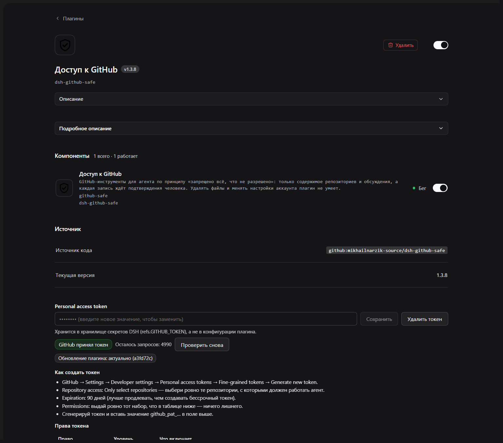

# Доступ к GitHub — подробное описание

Плагин `dsh-github-safe` даёт ассистенту инструменты GitHub и держит жёсткую
границу: единственная проверка по allowlist перед каждым сетевым вызовом. Этот
файл — подробное руководство; краткая версия — в `README.md` плагина.

## Что это и зачем

GitHub — хранилище кода, задач и обсуждений. Агенту полезно уметь читать файлы,
искать по коду, смотреть pull request и задачи, а иногда — создавать задачу,
коммит или PR. Опасность в том, что обычная GitHub-интеграция выдаёт агенту
токен и широкий REST-клиент: теоретически доступен любой эндпоинт, включая
`PATCH /user`, добавление коллабораторов или удаление репозитория.

Здесь сделано иначе — **deny-by-default** (запрещено всё, что не разрешено):

- перед каждым сетевым вызовом один раз проверяется allowlist из 34 правил
  «метод + шаблон пути»;
- чтения разрешены, записи разрешены только перечисленные и каждая требует
  подтверждения человека;
- DELETE, аккаунт, профиль, организации, доступы, секреты и настройки
  репозитория закрыты навсегда — плагин прямо сообщает, что не умеет такое, и
  не ищет обходных путей.

Термины: **репозиторий** — проект на GitHub; **issue** — задача или обсуждение;
**pull request (PR)** — предложение изменить код; **коммит** — сохранённое
изменение; **токен (PAT)** — пароль для программного доступа; **квота** —
остаток разрешённых запросов в час; **allowlist** — список разрешённого.

## Как открыть

1. Левая панель DSH → **«Плагины»** (в старых версиях — «Настройки → Плагины»).
2. Карточка **«Доступ к GitHub»** → страница плагина.
3. Сверху блок **«Доступ к GitHub»**: поле **Personal access token**, вердикт
   проверки, остаток квоты, кнопки «Сохранить» / «Удалить токен» /
   «Проверить снова».
4. Ниже — «Как создать токен», «Права токена», «Не выдавай», «Что плагину
   разрешено», блок обновления и раздел **«Подробности»** (этот документ).

Токен можно сохранить только здесь — в карточке плагина. Карточка в списке
плагинов показывает бейдж «настроен» / «не настроен».

## Как пользоваться пошагово

1. **Создайте fine-grained PAT** на GitHub: Settings → Developer settings →
   Personal access tokens → Fine-grained tokens → Generate new token.
2. **Repository access** → **All repositories**. Иначе новые репозитории не
   видны, а `github_repo_create` не сработает.
3. **Expiration** → 90 дней.
4. **Repository permissions**:

| Право | Уровень | Что включает |
| --- | --- | --- |
| Metadata | Read | обязателен всегда |
| Contents | Read and write | чтение файлов, коммиты, релизы, поиск кода |
| Issues | Read and write | задачи и комментарии |
| Pull requests | Read and write | PR, ревью, комментарии, merge |
| Commit statuses | Read | статусы коммитов |
| Checks | Read | CI-проверки PR |
| Administration | Read and write | создание репозиториев |

Не выдавайте `Secrets`, `Collaborators`, `Actions (write)`, `Webhooks`,
`Deploy keys`: у плагина нет эндпоинтов, где они нужны.

5. **Generate token**, скопируйте `github_pat_…`.
6. Вставьте в поле на странице плагина и нажмите **«Сохранить»**. Ответ
   «Сохранено. Действует сразу, перезапуск не нужен». Вердикт должен стать
   «GitHub принял токен», рядом — остаток квоты.
7. Если токен уже был создан с `Contents → Read`, не перевыпускайте его:
   откройте токен на GitHub, поменяйте `Contents` на `Read and write` и
   сохраните. Значение токена не меняется, новые права действуют сразу.
8. Попросите ассистента выполнить действие. Запись покажет окно подтверждения с
   описанием операции; чтения проходят без него.
9. Обновление: кнопка «Обновить» на странице плагина или штатный менеджер
   плагинов; заголовок плашки называет плагин — «Доступ к GitHub: доступно
   обновление», строка версий — «Доступ к GitHub: <установленная> → <новая>».
   После установки перезапустите DSH.

## Примеры

**Чтения — без подтверждения.** Репозиторий (описание, видимость, язык,
лицензия, права токена), ветки, коммиты, файлы и каталоги, git-объекты, задачи и
комментарии, pull request (файлы, ревью, коммиты, проверки, diff), релизы, теги,
метки, языки, запуски Actions и workflow, поиск по репозиториям, задачам, коду и
коммитам.

**Записи — всегда через подтверждение.** Создать/прокомментировать/закрыть/
переоткрыть/изменить задачу; создать/изменить/смёржить PR; отправить ревью или
review-комментарий; создать релиз по существующему тегу; закоммитить один файл;
закоммитить пакет файлов одним коммитом; создать новый репозиторий в своём
аккаунте.

**Инструменты.**

| Инструмент | Запись | Назначение |
| --- | --- | --- |
| `github_status` | нет | токен, квота, allowlist, состояние обновления |
| `github_repo` | нет | метаданные репозитория и права токена |
| `github_file` | нет | файл или листинг каталога |
| `github_issue` | нет | список, задача, комментарии |
| `github_review` | нет | PR: файлы, ревью, CI, diff |
| `github_search` | нет | репозитории, задачи, код |
| `github_issue_write` | да | create/comment/close/reopen/update |
| `github_pr_write` | да | create/update/merge/review/comment |
| `github_file_write` | да | коммит одного файла |
| `github_push_files` | да | пакетный коммит через Git Data API |
| `github_release_create` | да | релиз по существующему тегу |
| `github_repo_create` | да | новый репозиторий в своём аккаунте |

**Примеры фраз.** «Прочитай README из репозитория …»; «Покажи открытые задачи …»;
«Создай задачу с заголовком … и описанием …»; «Закоммить файл … в ветку main»;
«Создай PR из ветки feature в main»; «Создай приватный репозиторий …». Для записей
DSH покажет окно подтверждения, где написано, что именно произойдёт
(«создать issue в owner/repo: „…“», «закоммитить файл … (N символов)»).

**Что происходит при отказе.** Вызов отклоняется до сети: на GitHub ничего не
меняется. Это же правило работает при политике подтверждений `never` — запись
отклоняется, а не выполняется молча.

## Что вы увидите

**Вердикты проверки токена.** Карточка проверяет токен запросом
`GET /rate_limit` при открытии и после сохранения. В браузер токен не
передаётся — только вердикт.

| Статус | Значение |
| --- | --- |
| 🟢 GitHub принял токен | `200`, рядом остаток квоты |
| 🔴 GitHub отклонил токен | `401`: истёк срок или не хватает прав |
| 🟡 GitHub не ответил | сеть, таймаут, 5xx |
| ⚪ Токен не сохранён | в хранилище секретов пусто |

**Страница плагина.** Поле токена (маскированное; при сохранённом токене
placeholder «•••••••• (введите новое значение, чтобы заменить)»), кнопки
«Сохранить» / «Удалить токен» / «Проверить снова», строка статуса, «Осталось
запросов: N», блок «Как создать токен» (5 шагов), таблица прав, подсказки
(`All repositories`, что `Administration` нужен только для создания
репозиториев, как добавить права существующему токену), блок «Не выдавай», блок
«Что плагину разрешено», блок «Обновление плагина» и «Подробности».

**В списке плагинов.** Бейдж «настроен» / «не настроен». Если в `main`
репозитория появился новый коммит — бейдж «Доступ к GitHub: доступно
обновление: … → …».

**В чате.** Окно подтверждения с описанием операции; после выполнения — короткий
отчёт инструмента (номер issue, ссылка на PR, «Создан репозиторий …: ссылка»).
`github_status` печатает актуальный allowlist целиком — это не документация, а
то же объявление, по которому работает проверка.


**Внешний вид.** Секция центрирована: контейнер до 960 px, отступы 24/28/40 px,
сверху квадрат 52×52 с 🔐, заголовок 20 px, подпись в две строки, статус-чип с
точкой и secondary-кнопка «Обновить» (32 px). Карточки-секции — фон слоя 1, рамка
слоя 2, радиус 14 px, padding 16 px, акцентная полоска 3×14 px у заголовка.
Кнопки — 36 px и радиус 10 px, поле токена — 34 px и радиус 9 px; строки таблицы
прав и списки подсвечиваются при наведении.

**Кнопки и адаптив.** Кнопки одной системы: высота 36 px (шапка 32), padding
0 14 px, радиус 10 px, ширина по тексту, flex-wrap у строк действий. Primary —
мягкая заливка brand 18 % с рамкой brand 55 % и brand-текстом (не белая заливка
с белым текстом: в тёмной теме brand сам белый); secondary — рамка layer-l4 и
label-primary; danger — мягкий красный с красным текстом. Широкий блок «Права
токена» обёрнут в контейнер с `overflow-x: auto`: таблица прокручивается внутри
карточки, а страница — нет. Длинный текст переносится (`overflow-wrap:anywhere`),
медиазапросы 900 и 640 px уменьшают отступы; проверено на 1280, 1024, 768 и
480 px — горизонтальной прокрутки страницы нет.

## Как это выглядит


*Рисунок 1. Страница плагина: описание, настройки и кнопки.*



*Рисунок 2. Рабочий раздел плагина: органы управления и результат.*

## Частые ошибки и что делать

| Симптом | Причина | Что сделать |
| --- | --- | --- |
| «Токен не настроен» | токен не сохранён | «Плагины» → «Доступ к GitHub» → вставить и сохранить |
| «GitHub отклонил токен» / 401 | истёк, отозван, нет прав | новый токен или правка прав; сохранить |
| «GitHub не ответил» / «Не удалось связаться с GitHub» | сеть, прокси, сбой GitHub | проверить сеть, «Проверить снова», повторить позже |
| «Хранилище секретов доступно только для чтения» | профиль запрещает запись из интерфейса | вписать `refs.GITHUB_TOKEN` вручную в хранилище секретов DSH (`~/.dsh/.credentials.yaml`); файл отслеживается, значение подхватывается без перезапуска |
| Коммит отклонён с 403/404 | у токена нет `Contents: Read and write` | поправить права токена, сохранить; перевыпуск не нужен |
| «Запрос отклонён» | вы не подтвердили действие | на GitHub ничего не изменилось; повторить и подтвердить |
| Создание репозитория не работает | нет `Administration` | добавить право или создать репозиторий вручную |
| Репозиториев не видно | `Only select repositories` | выбрать `All repositories` |
| «Лимит запросов исчерпан» (403/429) | квота токена выбрана | дождаться сброса квоты (она видна в карточке) |
| После обновления старая версия | новый код подхватывается при перезапуске | перезапустить DSH |
| «Неизвестная модель» / странные ошибки аргументов | ассистент передал неверные параметры | уточнить запрос; инструмент вернёт текст ошибки |

## Ограничения и безопасность

**Запрещено всегда:**

| Что | Почему |
| --- | --- |
| `DELETE` любого эндпоинта | нельзя удалить репозиторий, ветку, тег, релиз, файл, хук |
| `/user`, `/users/*` | профиль владельца токена; исключение — только `POST /user/repos` (создание нового репозитория), и оно тоже требует подтверждения |
| `/orgs/*`, `/teams/*` | организации, участники, приглашения |
| `/apps`, `/installations`, `/marketplace_listing`, `/admin`, `/graphql` | приложения, установки, админка, GraphQL |
| `collaborators`, `invitations`, `hooks`, `keys`, `actions/secrets`, `actions/variables`, `transfer`, `subscription`, `pages` | доступы, секреты, передача, биллинг |
| `PATCH /repos/{o}/{r}`, `/topics` | видимость, архивация, темы репозитория |

Дополнительно: нет GraphQL, нет загрузки бинарных ассетов релиза, нет работы с
организациями и командами.

**Изоляция.** В коде нет `node:child_process`: плагин не запускает процессы и не
вызывает `gh`, `curl` или `git push`. Единственный сетевой адрес —
`https://api.github.com`, редиректы запрещены (`redirect: 'error'`), поэтому
заголовок `Authorization` не может уехать на другой хост. Ответы ограничены по
времени (20 секунд) и размеру (512 КБ); токен вырезается из любых
диагностических строк.

**Токен.** Читается **только** из `refs.GITHUB_TOKEN` хранилища секретов DSH
(`~/.dsh/.credentials.yaml`). Переменные окружения, конфиг и состояние плагина
не используются. Токен резолвится на каждую операцию, поэтому отзыв или замена
действуют немедленно. В браузер токен не передаётся.

**Подтверждения.** Все записи проходят через `tools/pre-execute` и требуют
решения человека: при политике `never` вызов отклоняется. Причина и описание
операции печатаются заранее, чтобы решение было осознанным.

**Системный промпт.** Плагин добавляет в системный промпт секцию
`tool:github-safe`: модель знает, что чтения свободны, записи ждут
подтверждения, а удаление, аккаунт, организации и доступы недоступны. Если
токена нет, промпт предписывает остановиться и сказать, где токен вводится, а не
искать обходные пути. Состояние токена и обновления передаются переменными
`{{github_token_state}}` и `{{github_update_state}}`.

**Лимиты.** Квота запросов у токена общая с другими программами на этой машине.
Плагин не является официальным продуктом DeepSeek или GitHub.

## Связанные плагины

- **dsh-review** — ревью, тесты, коммит, push и PR из DSH; `github-safe`
  добавляет агенту чтение PR и задач и создание issue через API.
- **dsh-cards** — карточки с кнопками: «Опубликовать» делает `git push`, а
  `github-safe` может создать репозиторий и PR.
- **dsh-vault** — зашифрованный сейф: хранит `refs.GITHUB_TOKEN` и переносит
  секреты на другие устройства.
- **dsh-sync** — синхронизация истории через приватный GitHub-репозиторий;
  работает, когда GitHub-токен уже сохранён.
- **dsh-notify** — уведомления о завершении длинных операций.

## Установка и проверка

```powershell
dsh plugin --profile desktop add github:mikhailnarzik-source/dsh-github-safe
node test/policy.test.mjs
```

В npm опубликована версия 1.0.0 без проверки обновлений — ставьте из
репозитория. Тест проверяет разрешённые чтения и записи, запрет `DELETE`,
`/user`, `/users`, `/orgs`, `/apps`, `collaborators`, `hooks`,
`actions/secrets`, `transfer`, смену настроек репозитория и обходы пути (`..`,
`//`, `\`, query в пути).
